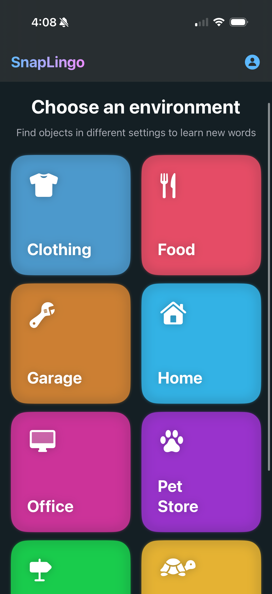
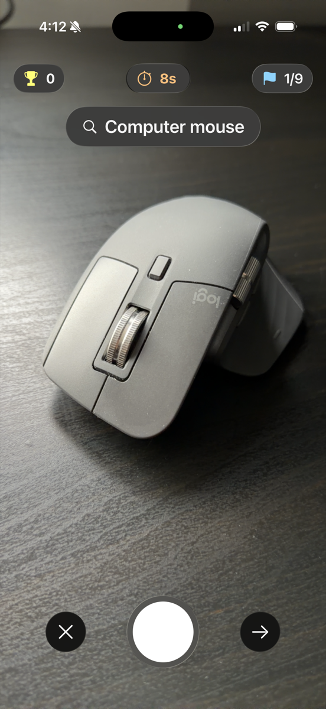
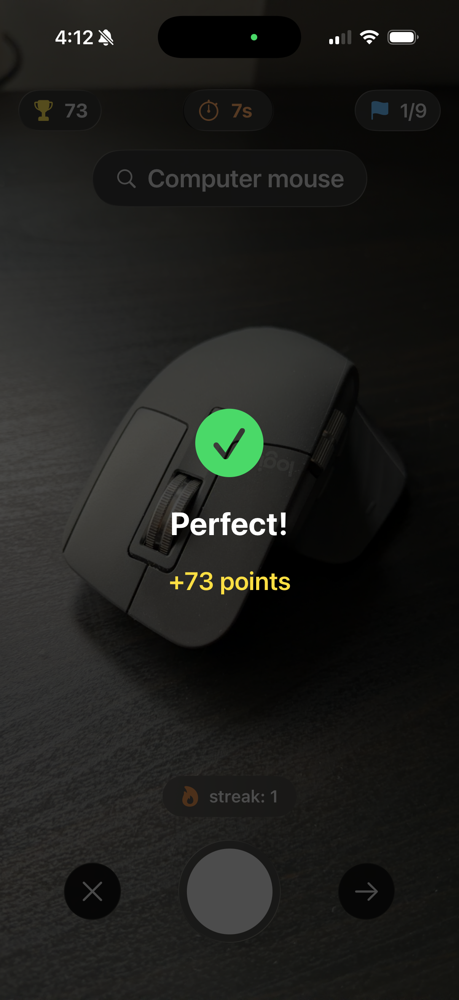

<div align="center">

# 📸 SnapLingo

**Learn new words by finding them in the real world.**

A gamified, photo-based vocabulary scavenger hunt built for the **Swift Student Challenge 2026**.


</div>

---

## ✨ Overview

SnapLingo turns vocabulary practice into a race against the clock. Pick an environment, and the app prompts you to find an everyday object around you. Point your camera, snap a photo, and an on-device model checks whether you found the right thing — then teaches you the word in the language you're learning.

## 📱 Screenshots

<div align="center">
<table>
  <tr>
    <td align="center" width="33%">
      
    </td>
    <td align="center" width="33%">
      
    </td>
    <td align="center" width="33%">
      
    </td>
  </tr>
  <tr>
    <td align="center"><b>1. Choose an environment</b><br/><sub>Pick where you'll hunt for words</sub></td>
    <td align="center"><b>2. Find the object</b><br/><sub>Snap it before the timer runs out</sub></td>
    <td align="center"><b>3. Score points</b><br/><sub>Faster finds earn more; keep the streak going</sub></td>
  </tr>
</table>
</div>

## 🎮 Features

| | |
|---|---|
| 🔍 **Photo scavenger hunt** | Find each prompted object within a 15-second timer |
| 🧠 **On-device recognition** | A FastViT-T8 Core ML model verifies what you photograph |
| 🏠 **Multiple environments** | Clothing, Food, Garage, Home, Office, Pet Store, Street, Zoo, and more |
| 🌍 **13 languages** | English, Spanish, French, German, Italian, Portuguese, Korean, Chinese, Arabic, Farsi, Japanese, Turkish, Polish |
| 🔥 **Scoring & streaks** | Points for speed and accuracy, plus bonuses for consecutive finds |
| ✈️ **Fully offline** | No network connection required, ever |

## 🚀 Getting Started

### Requirements

- Xcode 16+
- iOS 26 deployment target
- A device with a camera (recommended — the simulator has no camera feed)

### Build & Run

1. Open `SnapLingo.xcodeproj` in Xcode
2. Select the **SnapLingo** scheme and your target device
3. Press **⌘R** to build and run

Or from the command line:

```bash
xcodebuild -scheme SnapLingo -destination 'platform=iOS Simulator,name=iPhone 15' build
```

## 🗂️ Project Structure

```
SnapLingo/
├── SnapLingoApp.swift          # App entry point & model container
├── Models.swift                # SwiftData models and app types
├── GameManager.swift           # Game state and logic
├── Extensions.swift
├── Data/
│   └── catalog.json            # Environments, objects & translations
├── Services/
│   ├── CameraService.swift
│   ├── CatalogStore.swift
│   ├── ImageClassificationService.swift
│   ├── ObjectVerificationService.swift
│   └── VolumeButtonShutterService.swift
└── Views/
    ├── SetupView.swift
    ├── HomeMenuView.swift
    └── GameSessionView.swift
```

---

<div align="center">
<sub>Made with ❤️ and SwiftUI for the Swift Student Challenge 2026</sub>
</div>
